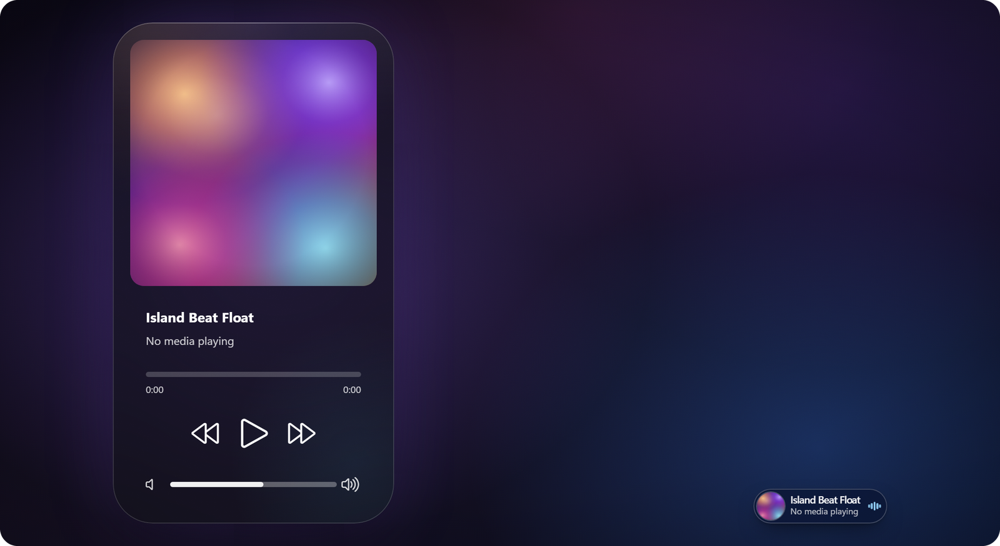

# Island Beat Float

**Dynamic Island style floating music controller for Windows.**

  

Island Beat Float puts the current media session into the Windows 11 taskbar as
a compact, clickable island: artwork, title, artist, playback state and progress
at a glance. Click it and the island expands into a floating player with a
seekable progress bar and previous / play-pause / next controls, morphing
smoothly back into the compact island when it closes.

## Features

- **Compact taskbar island** - artwork, title, artist and progress in one slim
  pill, with seven placement positions (near the tray, around the clock, or at
  either taskbar edge).
- **Circular compact cover** - the collapsed artwork is clipped to a circle
  whose diameter follows the island's inner height, so its curvature lines up
  with the pill's rounded ends; the expanded cover stays a rounded square.
- **Compact arc spin toggle** - a 77-degree accent-coloured arc hugs the right
  side of the circular cover without touching the artwork. Click it to spin the
  cover like a vinyl record (~33 deg/s); click again to freeze it, or
  double-click to stop it and snap the artwork back upright. The arc follows the
  same accent colour as the equalizer bars and survives popup open/close,
  settings changes and Explorer restarts.
- **Roomier compact text** - the title/artist block starts 50 DIP from the pill
  edge with a tight right margin, so long titles get the full available width
  while the layout keeps even spacing between cover, arc, text and equalizer.
- **Idle state and accent colour** - an optional default cover image plus
  fallback title/artist shown before a media session starts, and an accent that
  either follows the album artwork palette or uses a fixed custom colour.
- **Expanded floating player** - large artwork, seekable progress, transport
  controls, album-colour wash, optional single-card layout and a fluid
  open/close morph.
- **Materials** - Mica-like, Solid, Acrylic / glass and Liquid Glass, with an
  album gradient option, adjustable corner radius and optional screen-capture
  exclusion for the expanded panel.
- **Artwork pipeline** - session artwork with adaptive palette extraction; for
  low-resolution browser/video thumbnails it can generate mesh-gradient or
  flame artwork instead.
- **Taskbar-aware** - follows the taskbar when it moves, stays anchored above
  it, adapts the expand direction and only raises the expanded panel above
  shell surfaces.
- **Animations** - hover scale and smoothing, spring-based panel animation,
  crossfade + vertical-settle title/artist changes (no horizontal sliding), and
  a slow-motion preview speed. Opening the player and collapsing it back are
  seamless and flash-free.
- **Music app integrations** - NetEase Cloud Music (playback, progress, seek,
  favourite, artwork) and Bilibili (now-playing metadata) in addition to
  standard Windows media sessions, plus multi-monitor taskbar support. NetEase
  progress now resets to 00:00 for the new track on any song change (in-app or
  from the island) and stays calibrated while playing.
- **Faster startup** - the island is injected as soon as the taskbar XAML is
  ready (short retry cadence for the first seconds) instead of waiting for a
  media snapshot or the next media event.

## Screenshots

| Compact island | Expanded player |
| :---: | :---: |
|  |  |

## What's new in 3.1.19

- The compact arc spin toggle (77 degrees, 4.5 DIP thick, 2.7 DIP off the cover)
  with single-click spin and double-click stop-and-reset.
- NetEase Cloud Music progress sync: in-app track changes start at 00:00 instead
  of inheriting the previous song, with periodic recalibration and a seek hold.
- Flash-free collapse and a resting compact state that always shows the arc.
- Crossfade + vertical-settle title/artist transition.
- Faster cold-start injection.

## Installation

1. Install [Windhawk](https://windhawk.net/).
2. Open Windhawk → **Mods** → **Create a New Mod**.
3. Use `island-beat-float` as the mod identifier, paste the contents of
   [`island-beat-float.wh.cpp`](island-beat-float.wh.cpp), then compile.
4. Install and enable the mod, then restart Explorer.

Disabling the mod restores the native taskbar clock content.

## Settings

All options are grouped in the settings page: **Placement**, **Size and
margins**, **Expanded player**, **Appearance**, **Artwork**, **Animation** and
**Advanced**. Highlights include island position, height (28-72 DIP) and width,
expanded panel width and layout, material and Liquid Glass options, album wash,
artwork mode, default cover image and idle title/artist, accent colour mode,
hover/animation speed and advanced backdrop/capture options. The mod
description is localized for English and Chinese.

## Compatibility

Windows 11 only. Tested on Windows 11 26H2 (build 26300). The mod hooks internal
taskbar symbols, so future Windows updates may require an updated version.

## Credits and license

Island Beat Float is a heavily reworked fork of **Island Media Controls** by
[usho](https://github.com/usho-lear), used under the MIT license. Many thanks to
the original author for the foundation.

MIT licensed - see [LICENSE](LICENSE).
