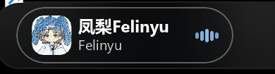
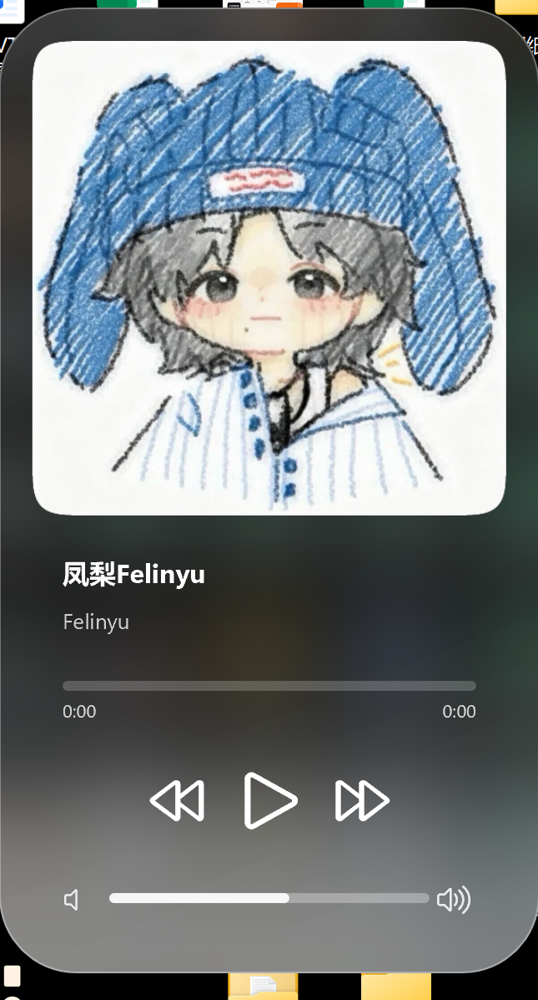

# Island Beat Float

**Dynamic Island style floating music controller for Windows.**

  

Island Beat Float puts the current media session into the Windows 11 taskbar as
a compact, clickable island: artwork, title, artist, playback state and progress
at a glance. Click it and the island expands into a floating player with a
seekable progress bar and previous / play-pause / next controls, morphing
smoothly back into the compact island when it closes.

## Features

- **Compact taskbar island** - artwork, title, artist and progress in one slim
  pill, with seven placement positions (near the tray, around the clock, or at
  either taskbar edge).
- **Expanded floating player** - large artwork, seekable progress, transport
  controls, album-colour wash, optional single-card layout and a fluid
  open/close morph.
- **Materials** - Mica-like, Solid, Acrylic / glass and Liquid Glass, with an
  album gradient option, adjustable corner radius and optional screen-capture
  exclusion for the expanded panel.
- **Artwork pipeline** - session artwork with adaptive palette extraction; for
  low-resolution browser/video thumbnails it can generate mesh-gradient or
  flame artwork instead.
- **Taskbar-aware** - follows the taskbar when it moves, stays anchored above
  it, adapts the expand direction and only raises the expanded panel above
  shell surfaces.
- **Animations** - hover scale and smoothing, spring-based panel animation and
  a slow-motion preview speed.
- **Music app integrations** - NetEase Cloud Music (playback, seek, favourite,
  artwork) and Bilibili (now-playing metadata) in addition to standard Windows
  media sessions, plus multi-monitor taskbar support.

## Screenshots

| Compact island | Expanded player |
| :---: | :---: |
|  |  |

## Installation

1. Install [Windhawk](https://windhawk.net/).
2. Open Windhawk → **Mods** → **Create a New Mod**.
3. Use `island-beat-float` as the mod identifier, paste the contents of
   [`island-beat-float.wh.cpp`](island-beat-float.wh.cpp), then compile.
4. Install and enable the mod, then restart Explorer.

Disabling the mod restores the native taskbar clock content.

## Settings

All options are grouped in the settings page: **Placement**, **Size and
margins**, **Expanded player**, **Appearance**, **Artwork**, **Animation** and
**Advanced**. Highlights include island position/height/width, expanded panel
width and layout, material and Liquid Glass options, album wash, artwork mode,
hover/animation speed and advanced backdrop/capture options. The mod
description is localized for English and Chinese.

## Compatibility

Windows 11 only. Tested on Windows 11 26H2 (build 26300). The mod hooks internal
taskbar symbols, so future Windows updates may require an updated version.

## Credits and license

Island Beat Float is a heavily reworked fork of **Island Media Controls** by
[usho](https://github.com/usho-lear), used under the MIT license. Many thanks to
the original author for the foundation.

MIT licensed - see [LICENSE](LICENSE).
